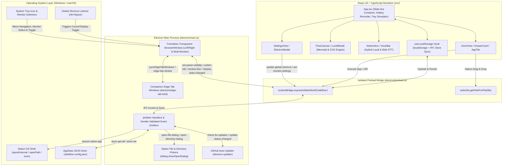

# SideFlow — Background Slide-Out Desktop Utility Panel

**SideFlow** is a cross-platform, always-available desktop background utility built with **Electron**, **React 18**, **TypeScript**, **Tailwind CSS**, and **Lucide Icons**. Designed for developers, architects, and power users, SideFlow lives quietly in the OS system tray (`skipTaskbar: true`) and slides out smoothly from the left or right edge of your primary or multi-monitor setup via a configurable global keyboard shortcut (default: `Alt + Space`), system tray menu, or subtle screen-edge peek handles.

It unifies three high-frequency daily workflows into a single zero-context-switching glassmorphic panel—and includes an interactive **Desktop Simulation Mode** when run in a standard web browser.

---

## Table of Contents

1. [Executive Summary & Core Workflows](#1-executive-summary--core-workflows)
   - [ObjectDock-Style Categorized App Drawers](#11-objectdock-style-categorized-app-drawers)
   - [On-The-Fly Flowchart Scratchpad with Lucidchart Mermaid Bridge](#12-on-the-fly-flowchart-scratchpad-with-lucidchart-mermaid-bridge)
   - [Voice-Dictated Multi-Note Scratchpad](#13-voice-dictated-multi-note-scratchpad)
   - [Configurable Global Hotkey Recorder & Window Management](#14-configurable-global-hotkey-recorder--window-management)
2. [Architecture & Tech Stack](#2-architecture--tech-stack)
3. [Project Directory Structure](#3-project-directory-structure)
4. [Getting Started](#4-getting-started)
   - [Prerequisites & Installation](#41-prerequisites--installation)
   - [Development Web Mode](#42-development-web-mode)
   - [Native Electron Tray Mode](#43-native-electron-tray-mode)
   - [Production Build & Packaging](#44-production-build--packaging)
   - [Running Automated Tests](#45-running-automated-tests)
5. [IPC Channels & Data Models Reference](#5-ipc-channels--data-models-reference)
   - [Electron IPC Channels](#51-electron-ipc-channels)
   - [Preload ContextBridge API (`window.sideflow`)](#52-preload-contextbridge-api-windowsideflow)
   - [Core TypeScript Data Models (`src/types/sideflow.ts`)](#53-core-typescript-data-models-srctypessideflowts)
   - [Workspace Persistence Keys](#54-workspace-persistence-keys)

---

## 1. Executive Summary & Core Workflows

### 1.1 ObjectDock-Style Categorized App Drawers
Organize and launch local executables, scripts, folders, web URLs, and custom application URI protocols from categorized, collapsible drawers:
- **ObjectDock Hover Physics:** App tiles animate with spring magnification on hover (`translateY(-6px) scale(1.12)` via `cubic-bezier(0.34, 1.56, 0.64, 1)`).
- **Categorized Drawer Management:** Create, double-click to rename, collapse/expand, filter via horizontal category pills, or delete drawers (e.g., *Development & Code*, *Diagramming & Creative*, *Communication & Media*).
- **Direct OS Drag-and-Drop:** Drag `.exe`, `.lnk`, `.app`, `.bat`, `.cmd`, `.sh`, `.ps1`, `.py`, media files, design assets, or URLs directly from Windows Explorer or macOS Finder onto any Drawer Card.
  - Drawers highlight with an indigo glow (`drawer-drop-active`) on `dragover`.
  - Native file paths are resolved via Electron's `webUtils.getPathForFile(file)` (with fallback support), and `inferAppMetaFromFilename()` automatically derives a clean display title, Lucide icon, and accent color based on file extension.
- **Native File Browser Dialog:** Each drawer header and the **Add / Edit App** modal include a **Browse** button wired to Electron's native `dialog.showOpenDialog` (`openFile`, `multiSelections`).
- **Instant Filter & Direct Launch:** Filter across all drawers in real time and press `Enter` in the search bar to immediately launch the top matching application or URL/URI command.
- **Hybrid Native Execution Engine:** Clicking any tile dispatches `launch-native-app` over IPC. Standard URLs and custom URI schemes (`vscode://`, `figma://`, `spotify://`, `slack://`, `ms-calculator://`) execute via `shell.openExternal()`, while local file paths execute via `shell.openPath()` with an automatic `child_process.exec` fallback.

### 1.2 On-The-Fly Flowchart Scratchpad with Lucidchart Mermaid Bridge
Rapidly sketch system architectures, decision trees, and API flows without leaving your active workspace:
- **Three Semantic Node Shapes:**
  - **Process (`process`):** Rounded rectangle in Sky Blue (`bg-sky-950/90`, `border-sky-400/70`)
  - **Decision (`decision`):** Dashed-border diamond/rounded-2xl card in Amber (`bg-amber-950/90`, `border-amber-400/80`)
  - **Terminal / Start-End (`start`):** Pill shape in Emerald (`bg-emerald-950/90`, `border-emerald-400/80`)
- **Interactive Drag & Inline Editing:** Freely drag nodes across the 20px dot-grid canvas with real-time edge recalculation. Double-click any node's label to rename it inline (`Enter` to commit, `Escape` to cancel).
- **Directed Cubic-Bezier Connectors:** Toggle **Connect** mode, click a source node, and click a target node to draw a smooth SVG cubic-bezier curve with an indigo arrowhead marker (`#arrowhead`). Click any connector path to remove it.
- **Bi-Directional Lucidchart Mermaid Bridge:**
  - Open **Lucidchart Sync** to auto-compile the canvas state into standard **Mermaid.js (`flowchart TD`)** syntax:
    - Process: `n1["Label"]`
    - Decision: `n2{"Label"}`
    - Terminal: `n3(["Label"])`
    - Directed Edges: `n1 --> n2` (or `n1 -->|Label| n2`)
  - Edit Mermaid code directly in the modal and click **Sync to Canvas** (`parseMermaidCode`) to reconstruct nodes and edges back on the visual canvas, **Copy Code** for one-step paste into Lucidchart (`Insert -> Mermaid`), or launch Lucidchart documents directly.
- **Standalone SVG Export:** Click **Download SVG** (`generateStandaloneSVG`) to export a self-contained, styled `.svg` file of the diagram.

### 1.3 Voice-Dictated Multi-Note Scratchpad
Capture meeting notes, sprint tasks, and voice memos with zero friction:
- **Multi-Note Pill Navigation:** Create, switch between, title, and delete multiple persistent notes.
- **Real-Time Web Speech API Dictation:**
  - Click the microphone button (with pulsing red recording ring `.recording-pulse`) to stream live speech-to-text into the active note using `SpeechRecognition` / `webkitSpeechRecognition` (`continuous: true`, `interimResults: true`).
  - Supports language selection (`en-US`, `en-GB`, `es-ES`, `fr-FR`, `de-DE`, `ja-JP`), live interim transcript preview, automatic restart on speech end while active, and a graceful simulated dictation fallback when running in restricted/sandboxed browser environments without microphone access.
- **Quick Note Utilities:** One-click **Insert Timestamp** (`[HH:MM AM/PM]`), one-click **Copy Note** to clipboard, and a live word/character counter with automatic local save indicator.

### 1.4 Configurable Global Hotkey Recorder & Window Management
Customize how SideFlow integrates with your desktop and multi-monitor environment:
- **Interactive Keybinding Recorder:** In the **Settings** tab, click *"Click & Press New Shortcut Combo"* and press any modifier + key combination (e.g., `Alt + Space`, `Ctrl + Shift + Space`, `Alt + Q`). SideFlow updates the UI state and dynamically re-binds Electron's `globalShortcut.register()` via IPC, updating the System Tray tooltip and context menu label in real time.
- **Pin vs. Auto-Hide Mode:**
  - **Pinned:** Keeps the panel open alongside other desktop windows.
  - **Auto-Hide (Unpinned):** Automatically retracts the panel when the window loses focus (`window-blur` event in Electron or clicking the desktop background in Web Simulation mode).
- **Multi-Monitor Display & Screen Routing:** Configure how SideFlow spans connected displays from **Settings** or the System Tray **Monitor Display** submenu:
  - **Primary Only (`primary`):** Docks SideFlow exclusively on the OS primary display.
  - **Single Monitor (`single`):** Pins SideFlow to any specific connected display (`targetDisplayId`).
  - **All Monitors (`all`):** Follow-mouse mode—pressing the global shortcut opens or moves SideFlow onto the monitor currently holding the mouse cursor, while secondary monitors display companion edge tabs.
  - **Selected Monitors (`custom`):** Enables follow-mouse routing and companion edge tabs across a user-selected subset of monitors (`enabledDisplayIds`), ensuring at least one monitor always stays active.
  - **Per-Monitor Bezel Edge Overrides:** Override global Left/Right docking per monitor (`Default`, `Left`, `Right`) or click **Use Outer Bezels** to automatically dock on the leftmost display's left bezel and rightmost display's right bezel.
- **Screen-Edge Peek Handle & Companion Edge-Tab Windows:** When retracted, an optional click-through-aware peek handle (`#edge-peek-handle`) remains docked on the active monitor's configured edge (displaying a pulsing indicator whenever voice dictation is active). When multiple monitors are enabled (`all` or `custom`), lightweight frameless **Companion Edge-Tab** windows (`40×96px`, `electron/edge-tab.html`) appear on secondary enabled monitors for one-click cross-monitor summoning—paired with an interactive multi-monitor simulation bar in Web Preview Mode.
- **Left / Right Panel Edge & Custom Width:** Dock the panel to either the **Left** or **Right** screen edge (`sideflow_panel_edge`) and adjust extended panel width from **15% to 90%** of the active display's work area (`sideflow_panel_width_percent`, default `35%`, minimum `320px`) via Settings presets/slider or by dragging/keyboard-adjusting (`ArrowLeft`/`ArrowRight`, `Home`/`End`) the panel's inner resize border.
- **GitHub Auto-Updates & Login Startup:** Built-in `electron-updater` checks GitHub Releases automatically on launch and every 4 hours, providing live download progress, one-click **Restart & Install Update**, and a **Start SideFlow at Login** toggle (`sideflow_open_at_login`) in Settings and the System Tray menu.
- **Workspace Backup, Import & Reset:** Export or import all drawers, flowcharts, notes, shortcut bindings, panel dimensions, and multi-monitor routing settings as a portable `sideflow-backup.json` file, or restore factory defaults with one click.

---

## 2. Architecture & Tech Stack

SideFlow uses a strict process-isolated Electron architecture paired with a dual-mode React 18 frontend that runs seamlessly as both a native OS tray application and a standalone web application.



### Technology Stack Summary

| Layer | Technology | Purpose |
| :--- | :--- | :--- |
| **Desktop Shell** | **Electron 33** (`electron`, `electron-builder`, `electron-updater`) | Sandboxed frameless always-on-top overlay, multi-monitor companion edge tabs, System Tray, `globalShortcut`, GitHub auto-updates, native file & URI execution |
| **Frontend UI** | **React 18.3** + **TypeScript 5.7** | Component architecture, strongly typed state, custom hooks |
| **Build Tooling** | **Vite 6** + `concurrently` + `wait-on` | Instant HMR for web and synchronized Electron development |
| **Styling** | **Tailwind CSS 3.4** + Custom CSS3 Physics | Dark glassmorphism (`backdrop-blur-2xl`), cubic-bezier slide transitions, ObjectDock hover scaling |
| **Icons** | **Lucide React** (`lucide-react`) | Dynamic icon resolution (`DynamicIcon.tsx`) across drawers, tiles, and toolbars |
| **Persistence** | `localStorage` + Electron `userData` JSON Store | Instant synchronous state updates backed by `sideflow-config.json` in native mode |
| **Testing** | **Vitest 2** + **React Testing Library** + `jsdom` | Automated unit and component integration testing |

---

## 3. Project Directory Structure

```text
SideFlow/
├── electron/
│   ├── main.ts                         # Electron Main Process: BrowserWindow, multi-monitor companion windows, Tray, auto-updater, IPC, JSON store
│   ├── preload.ts                      # ContextBridge exposing safe window.sideflow API & webUtils.getPathForFile
│   ├── edge-tab.html                   # Lightweight frameless companion edge-tab window shell for secondary monitors
│   ├── edge-tab.js                     # Companion edge-tab renderer logic (hover click-through toggle, dictation badge, click-to-summon)
│   ├── stt_worker.py                   # Optional local Python faster-whisper / CUDA / CPU speech-to-text worker
│   └── icon.png                        # System tray & application icon asset
├── src/
│   ├── components/
│   │   ├── DockDrawers/
│   │   │   ├── AppTile.tsx             # ObjectDock-style magnified app tile with edit/remove actions
│   │   │   ├── DockView.tsx            # Search bar, category filter pills, drawer list, Add/Edit App & Drawer modals
│   │   │   └── DrawerCard.tsx          # Collapsible category drawer with native file/URL drag-and-drop zone
│   │   ├── Flowchart/
│   │   │   ├── FlowCanvas.tsx          # Interactive SVG bezier edge layer + draggable HTML nodes editor
│   │   │   └── LucidModal.tsx          # Bi-directional Mermaid.js generator/parser & Lucidchart launcher
│   │   ├── Notes/
│   │   │   ├── NotesView.tsx           # Multi-note tab bar, title/body editor, word/char counter
│   │   │   └── VoiceBar.tsx            # Web Speech API & local Whisper continuous dictation controller & tools
│   │   ├── Settings/
│   │   │   └── SettingsView.tsx        # Hotkey recorder, multi-monitor routing, panel edge/width, auto-updates, JSON backup/import/reset
│   │   ├── DynamicIcon.tsx             # Maps icon identifier strings to Lucide React components
│   │   ├── ElectronModal.tsx           # Reference modal displaying native Electron wrapper setup & code
│   │   ├── Header.tsx                  # Panel header with Pin/Auto-Hide toggle button, tab switcher, and collapse controls
│   │   ├── Modal.tsx                   # Accessible WCAG 2.2 AA dialog/alertdialog wrapper (focus trap, Escape, focus restore)
│   │   └── SideFlowIcon.tsx            # Branded SVG application emblem component
│   ├── hooks/
│   │   └── useLocalStorage.ts          # Persistent state hook synced with localStorage and Electron userData store
│   ├── test/
│   │   └── setup.ts                    # Vitest + @testing-library/jest-dom test environment setup
│   ├── types/
│   │   └── sideflow.ts                 # Core TypeScript interfaces (AppDrawer, FlowNode, MonitorSettings, AppUpdateState, etc.)
│   ├── utils/
│   │   ├── defaults.ts                 # Default drawers, starter flowchart, sample notes, shortcut, and multi-monitor routing helpers
│   │   ├── fileMeta.ts                 # File path extraction, extension-based icon/color inference, app execution
│   │   ├── localSttEngine.ts           # Hybrid local/WebGPU/native speech-to-text audio capture & dispatch engine
│   │   ├── mermaid.ts                  # Flowchart-to-Mermaid compiler, Mermaid-to-Flowchart parser, standalone SVG exporter
│   │   └── whisperWorker.ts            # WebGPU / WASM Transformers.js Whisper & Moonshine worker
│   ├── App.tsx                         # Root slide-out container, resize handle, global key listener, and Web Desktop Simulation view
│   ├── index.css                       # Tailwind directives, cubic-bezier transitions, ObjectDock hover & pulse animations
│   └── main.tsx                        # React 18 DOM entry point
├── CHANGELOG.md                        # Versioned release notes (Keep a Changelog)
├── index.html                          # HTML shell
├── package.json                        # Scripts, dependencies, and electron-builder packaging configuration
├── postcss.config.js                   # PostCSS configuration for Tailwind CSS
├── tailwind.config.js                  # Tailwind CSS theme and content scanning setup
├── tsconfig.json                       # TypeScript configuration for React renderer
├── tsconfig.electron.json              # TypeScript configuration for compiling electron/ to dist-electron/
└── vite.config.ts                      # Vite bundler and Vitest configuration
```

---

## 4. Getting Started

### 4.1 Prerequisites & Installation

- **Node.js:** `v18.0.0` or higher (LTS recommended)
- **npm:** `v9.0.0` or higher
- **OS:** Windows 10/11 or macOS (for native Electron tray packaging)

Install project dependencies from the repository root:

```bash
npm install
```

### 4.2 Development Web Mode

Run SideFlow in a standard web browser with Vite's Hot Module Replacement (HMR). When opened outside Electron, SideFlow automatically enables **Desktop Simulation Mode**, providing an interactive desktop background, top helper banner, multi-monitor cursor/edge-tab simulator, and simulated OS taskbar/system tray menu:

```bash
# Start Vite dev server at http://localhost:5173
npm run dev

# Preview the production web bundle locally
npm run preview
```

### 4.3 Native Electron Tray Mode

Launch SideFlow as a frameless, edge-docked native desktop overlay with live HMR, OS-level `Alt + Space` shortcut registration, System Tray icon, multi-monitor companion edge tabs, and native `.exe` / `.app` / URI launching:

```bash
# Run Vite dev server + compile Electron TypeScript + launch Electron concurrently
npm run electron:dev

# Or build both renderer and Electron main process and start Electron in production mode
npm run electron:start
```

### 4.4 Production Build & Packaging

Compile TypeScript, bundle the React frontend into `dist/`, compile the Electron main and preload scripts into `dist-electron/`, and package native desktop binaries via `electron-builder`:

```bash
# Compile TypeScript and build web + Electron bundles (dist/ and dist-electron/)
npm run build

# Package an unpacked native application directory into release/
npm run electron:pack

# Build distributable installers (NSIS & Portable .exe on Windows, .dmg on macOS) into release/
npm run electron:dist

# Build Windows NSIS installer and publish update artifacts to GitHub Releases
npm run electron:publish
```

### 4.5 Running Automated Tests

SideFlow uses **Vitest** and **React Testing Library** (`jsdom`) for automated verification:

```bash
# Execute the test suite once in CI/headless mode
npm test

# Run Vitest in interactive watch mode during development
npm run test:watch
```

---

## 5. IPC Channels & Data Models Reference

### 5.1 Electron IPC Channels

Implemented in [`electron/main.ts`](electron/main.ts) (with `isMainSender` and `isCompanionSender` origin verification on IPC handlers) and bridged in [`electron/preload.ts`](electron/preload.ts):

| IPC Channel | Direction | Transport | Payload | Behavior |
| :--- | :--- | :--- | :--- | :--- |
| `launch-native-app` | Renderer → Main | `invoke` | `command: string, args?: string[]` | Launches `http(s)://` URLs and custom URI schemes (`vscode://`, `spotify://`, etc.) via `shell.openExternal(command)`. Launches local file paths, scripts, and executables via `shell.openPath()` / `child_process`. Returns `{ success: boolean; error?: string }`. |
| `update-global-shortcut` | Renderer → Main | `invoke` | `accelerator: string` | Calls `globalShortcut.unregisterAll()`, normalizes and registers the new Electron accelerator (e.g., `Alt+Space`), and refreshes the System Tray menu and tooltip. Returns `boolean`. |
| `set-panel-visibility` | Bidirectional | `send` | `visible: boolean` | **Renderer → Main:** Updates `isPanelVisible`, toggles `mainWindow` click-through forwarding, focuses `mainWindow` when opening, and syncs companion edge-tab windows.<br>**Main → Renderer:** Triggered by the global hotkey, companion edge tab, or System Tray toggle to animate the panel open or closed. |
| `set-panel-edge` | Renderer → Main | `send` | `edge: 'left' \| 'right'` | Sets the global default screen edge, repositions `mainWindow` (cross-DPI safe), persists `sideflow_panel_edge`, and updates companion edge-tab windows. |
| `set-panel-width-percent` | Renderer → Main | `send` | `widthPercent: number` | Clamps panel width to `15`–`90`% of the active monitor's work area (`min 320px`), updates `mainWindow` bounds, and persists `sideflow_panel_width_percent`. |
| `set-ignore-mouse-events` | Renderer → Main | `send` | `ignore: boolean` | Enables or disables OS mouse click-through (`{ forward: true }`) on `mainWindow` when retracted so underlying desktop windows stay interactive while `#edge-peek-handle` remains hoverable. |
| `get-display-state` | Renderer → Main | `invoke` | `void` | Enumerates connected monitors via Electron `screen`, resolves active display and effective bezel edge, and returns `Promise<DisplayStatePayload>`. |
| `set-monitor-settings` | Renderer → Main | `invoke` | `settings: MonitorSettings` | Sanitizes and persists `sideflow_monitor_settings`, updates `mainWindow` bounds, refreshes the System Tray **Monitor Display** submenu, syncs companion edge-tab windows, and returns `Promise<DisplayStatePayload>`. |
| `activate-display` | Renderer → Main | `invoke` | `{ displayId: number; openPanel?: boolean } \| number` | Moves `mainWindow` onto the target enabled display (cross-DPI safe) and optionally opens/focuses the panel, returning `Promise<DisplayStatePayload>`. |
| `display-state-changed` | Main → Renderer | `webContents.send` | `DisplayStatePayload` | Broadcast when monitors are connected/disconnected/rescaled (`display-added`, `display-removed`, `display-metrics-changed`) or when monitor routing changes from the System Tray or Settings. |
| `set-edge-handle-state` | Renderer → Main | `send` | `{ showEdgeHandle: boolean; isDictating: boolean; shortcutLabel: string }` | Synchronizes peek-handle visibility, active voice-dictation status indicator, and shortcut tooltip text to secondary companion edge-tab windows. |
| `prepare-edge-tab-click` | Companion → Main | `send` | `void` | Temporarily suppresses `mainWindow` blur auto-retraction while interacting with a secondary monitor's companion edge tab. |
| `edge-tab-clicked` | Companion → Main | `send` | `displayId: number` | Summons and focuses the main SideFlow panel onto the clicked companion edge tab's monitor. |
| `set-companion-ignore-mouse` | Companion → Main | `send` | `{ displayId: number; ignore: boolean }` | Toggles OS click-through forwarding on a specific secondary companion `BrowserWindow` when hovering its visible tab button. |
| `edge-tab-update` | Main → Companion | `webContents.send` | `{ displayId, edge, isDictating, shortcutLabel, displayName?, isOpenElsewhere? }` | Pushes live bezel side, voice-dictation badge state, and tooltip updates to secondary companion edge-tab windows. |
| `open-file-dialog` | Renderer → Main | `invoke` | `void` | Opens the native OS file chooser (`['openFile', 'multiSelections']`) and returns `Promise<string[]>`. |
| `open-directory-dialog` | Renderer → Main | `invoke` | `void` | Opens the native OS folder picker (`['openDirectory']`) for live folder-synced drawers and returns `Promise<string \| null>`. |
| `read-directory-items` | Renderer → Main | `invoke` | `dirPath: string` | Reads directory entries and extracted native file icons for live folder-synced drawers, returning `Promise<DirectoryEntryItem[]>`. |
| `extract-file-icon` / `resolve-shortcut-item` | Renderer → Main | `invoke` | `filePath: string` | Resolves `.lnk`/executable targets and extracts native OS icons as `data:image/png;base64` URLs. |
| `get-system-metrics` / `get-running-processes` | Renderer → Main | `invoke` | `void` | Returns live CPU, RAM, uptime metrics (`SystemMetrics`) and active process names for dock running indicators. |
| `get-local-stt-status` / `transcribe-audio-local` | Renderer → Main | `invoke` | `void` / PCM16 audio payload | Detects local `faster-whisper` (CUDA/CPU) and Windows SAPI availability (`LocalSttStatus`) and transcribes recorded audio buffers offline (`LocalTranscriptionResult`). |
| `get-auto-launch` / `set-auto-launch` | Renderer → Main | `invoke` | `void` / `enabled: boolean` | Queries or updates OS login startup registration (`app.setLoginItemSettings`) and `sideflow_open_at_login`, returning `Promise<AutoLaunchState>`. |
| `get-update-status` / `check-for-updates` / `install-update-now` | Renderer → Main | `invoke` | `void` | Reads current `AppUpdateState`, triggers a GitHub Releases check via `electron-updater`, or invokes `autoUpdater.quitAndInstall()`. |
| `update-status-changed` | Main → Renderer | `webContents.send` | `AppUpdateState` | Streams auto-updater lifecycle transitions (`checking`, `available`, `downloading`, `downloaded`, `not-available`, `error`) and download progress to Settings. |
| `store-get-all` | Renderer → Main | `invoke` | `void` | Reads and parses `sideflow-config.json` from `app.getPath('userData')`, returning `Promise<Record<string, unknown>>`. |
| `store-set` | Renderer → Main | `send` | `{ key: string; value: unknown }` | Persists a key-value pair to `sideflow-config.json` in `app.getPath('userData')` and synchronizes main-process handle/monitor/shortcut state. |
| `switch-tab` | Main → Renderer | `webContents.send` | `tab: TabId` | Dispatched when the user selects *Open App Drawers*, *Quick Flowchart*, *Voice Dictation Notes*, or *Configure Hotkey & Settings* from the native System Tray menu. |
| `window-blur` | Main → Renderer | `webContents.send` | `void` | Emitted when `mainWindow` loses OS focus (`blur` event), allowing the renderer to auto-retract the panel when in **Auto-Hide** (unpinned) mode. |

---

### 5.2 Preload ContextBridge API (`window.sideflow`)

[`electron/preload.ts`](electron/preload.ts) exposes a strongly typed `window.sideflow` object via `contextBridge.exposeInMainWorld('sideflow', sideflowAPI)` with `contextIsolation: true`, `nodeIntegration: false`, and `sandbox: true`:

```typescript
export interface SideFlowElectronBridge {
  isElectron: boolean;
  launchNativeApp: (command: string, args?: string[]) => Promise<{ success: boolean; error?: string }>;
  updateGlobalShortcut: (accelerator: string) => Promise<boolean>;
  setPanelVisibility: (visible: boolean) => void;
  setPanelEdge?: (edge: PanelEdge) => void;
  setPanelWidthPercent?: (widthPercent: number) => void;
  setIgnoreMouseEvents?: (ignore: boolean) => void;
  getDisplayState?: () => Promise<DisplayStatePayload>;
  setMonitorSettings?: (settings: MonitorSettings) => Promise<DisplayStatePayload>;
  activateDisplay?: (displayId: number, openPanel?: boolean) => Promise<DisplayStatePayload>;
  setEdgeHandleState?: (state: {
    showEdgeHandle: boolean;
    isDictating: boolean;
    shortcutLabel: string;
  }) => void;
  onDisplayStateChanged?: (callback: (state: DisplayStatePayload) => void) => () => void;
  clickEdgeTab?: (displayId: number) => void;
  prepareEdgeTabClick?: () => void;
  setCompanionIgnoreMouse?: (displayId: number, ignore: boolean) => void;
  onEdgeTabUpdate?: (
    callback: (payload: {
      displayId: number;
      edge: PanelEdge;
      isDictating: boolean;
      shortcutLabel: string;
      displayName?: string;
      isOpenElsewhere?: boolean;
    }) => void
  ) => () => void;
  openFileDialog: () => Promise<string[]>;
  openDirectoryDialog?: () => Promise<string | null>;
  readDirectoryItems?: (dirPath: string) => Promise<DirectoryEntryItem[]>;
  extractFileIcon?: (filePath: string) => Promise<string | null>;
  resolveShortcutItem?: (rawPathOrName: string) => Promise<{
    name: string;
    cmd: string;
    args?: string;
    iconDataUrl: string | null;
  } | null>;
  getSystemMetrics?: () => Promise<SystemMetrics>;
  getRunningProcesses?: () => Promise<string[]>;
  getPathForFile: (file: File) => string;
  onSetPanelVisibility: (callback: (visible: boolean) => void) => () => void;
  onSwitchTab: (callback: (tab: TabId) => void) => () => void;
  onWindowBlur: (callback: () => void) => () => void;
  storeGetAll: () => Promise<Record<string, unknown>>;
  storeSet: (key: string, value: unknown) => void;
  getLocalSttStatus?: () => Promise<LocalSttStatus>;
  transcribeAudioLocal?: (payload: {
    pcm16Base64: string;
    sampleRate: number;
    lang: string;
    modelSize?: WhisperModelId;
    preferEngine?: SttEngineMode;
    promptContext?: string;
  }) => Promise<LocalTranscriptionResult>;
  getAutoLaunch?: () => Promise<AutoLaunchState>;
  setAutoLaunch?: (enabled: boolean) => Promise<AutoLaunchState>;
  getUpdateStatus?: () => Promise<AppUpdateState>;
  checkForUpdates?: () => Promise<AppUpdateState>;
  installUpdateNow?: () => Promise<{ success: boolean; error?: string }>;
  onUpdateStatus?: (callback: (state: AppUpdateState) => void) => () => void;
}
```

---

### 5.3 Core TypeScript Data Models (`src/types/sideflow.ts`)

Defined in [`src/types/sideflow.ts`](src/types/sideflow.ts):

```typescript
export type AccentColor = 'indigo' | 'cyan' | 'emerald' | 'amber' | 'rose' | 'purple';

export type TabId = 'drawers' | 'flowchart' | 'notes' | 'settings';

export type PanelEdge = 'left' | 'right';

export type MonitorMode = 'primary' | 'single' | 'all' | 'custom';

export interface MonitorDisplayInfo {
  id: number;
  index: number;
  label: string;
  isPrimary: boolean;
  bounds: { x: number; y: number; width: number; height: number };
  workArea: { x: number; y: number; width: number; height: number };
  scaleFactor: number;
}

export interface MonitorSettings {
  mode: MonitorMode;
  targetDisplayId?: number | null;             // Selected display ID when mode === 'single'
  enabledDisplayIds?: number[];                // Enabled display IDs when mode === 'custom'
  edgeOverrides?: Record<string, PanelEdge>;   // Optional per-monitor edge overrides keyed by String(displayId)
}

export interface DisplayStatePayload {
  displays: MonitorDisplayInfo[];
  activeDisplayId: number;
  effectiveEdge: PanelEdge;
  monitorSettings: MonitorSettings;
}

export interface AppItem {
  id: string;
  name: string;
  cmd: string;               // Full OS file path (C:\...\app.exe) or URI (vscode://)
  icon: string;              // Lucide icon identifier
  color: AccentColor;
  customIconUrl?: string;
  hotkey?: string;           // Optional per-app shortcut (e.g., "Alt+1")
}

export interface AppDrawer {
  id: string;
  title: string;
  collapsed: boolean;
  apps: AppItem[];
  folderPath?: string;       // Optional synced local folder path
  sortBy?: 'manual' | 'name' | 'type';
}

export type FlowNodeType =
  | 'process'
  | 'decision'
  | 'start'
  | 'database'
  | 'subroutine'
  | 'io'
  | 'circle'
  | 'hexagon'
  | 'asymmetric';

export interface FlowNode {
  id: string;
  type: FlowNodeType;
  text: string;
  x: number;
  y: number;
  color?: AccentColor;
  stereotype?: string;
  members?: string[];
}

export interface FlowEdge {
  from: string;
  to: string;
  label?: string;
  style?: 'solid' | 'dotted' | 'thick';
  arrow?: 'arrow' | 'none' | 'bidirectional' | 'circle' | 'cross';
  cardinality?: string;
  curve?: 'bezier' | 'orthogonal' | 'straight';
}

export interface FlowchartState {
  nodes: FlowNode[];
  edges: FlowEdge[];
  direction?: 'TD' | 'BT' | 'LR' | 'RL';
  subgraphs?: Array<{ id: string; title: string; nodeIds: string[] }>;
  diagramType?: 'flowchart' | 'stateDiagram-v2' | 'sequenceDiagram' | 'classDiagram' | 'erDiagram';
  edgeCurve?: 'bezier' | 'orthogonal' | 'straight';
}

export interface NoteItem {
  id: string;
  title: string;
  body: string;
  updatedAt?: number;
  pinned?: boolean;
  color?: AccentColor;
  tags?: string[];
}

export interface ShortcutConfig {
  alt: boolean;
  ctrl: boolean;
  shift: boolean;
  code?: string;
  key: string;
  label: string;             // e.g., "Alt + Space"
}

export type AppUpdateStatus =
  | 'idle'
  | 'checking'
  | 'available'
  | 'not-available'
  | 'downloading'
  | 'downloaded'
  | 'error';

export interface AppUpdateState {
  status: AppUpdateStatus;
  currentVersion: string;
  latestVersion?: string;
  releaseNotes?: string;
  releaseUrl?: string;
  downloadPercent?: number;
  error?: string;
  lastCheckedAt?: number;
  canQuitAndInstall?: boolean;
}

export interface AutoLaunchState {
  enabled: boolean;
  isPackaged: boolean;
}

export interface ToastMessage {
  id: string;
  title: string;
  subtitle: string;
  icon: string;
}
```

---

### 5.4 Workspace Persistence Keys

Managed via [`useLocalStorage`](src/hooks/useLocalStorage.ts) in `localStorage` and mirrored to `sideflow-config.json` in Electron's `userData` directory:

| Key | Type | Default | Description |
| :--- | :--- | :--- | :--- |
| `sideflow_drawers` | `AppDrawer[]` | `defaultDrawers` (3 categories, 10 apps) | Categorized ObjectDock drawers and application tiles |
| `sideflow_flow` | `FlowchartState` | `defaultFlowData` (4 nodes, 3 edges) | Flowchart canvas nodes, coordinates, and directed edges |
| `sideflow_notes` | `NoteItem[]` | `defaultNotes` (2 starter notes) | Multi-note scratchpad titles, bodies, tags, and timestamps |
| `sideflow_shortcut` | `ShortcutConfig` | `Alt + Space` | Active global keyboard shortcut configuration |
| `sideflow_pinned` | `boolean` | `true` | Whether the panel stays pinned (`true`) or auto-hides on outside click/blur (`false`) |
| `sideflow_edge_handle` | `boolean` | `true` | Whether screen-edge peek handles and companion edge tabs are visible when retracted |
| `sideflow_panel_edge` | `PanelEdge` | `'right'` | Global default screen edge (`'left'` or `'right'`) where SideFlow docks |
| `sideflow_panel_width_percent` | `number` | `35` | Extended panel width as a percentage (`15`–`90`%) of the active monitor's work area |
| `sideflow_monitor_settings` | `MonitorSettings` | `{ mode: 'primary', ... }` | Multi-monitor routing mode (`primary`, `single`, `all`, `custom`), target/enabled display IDs, and per-monitor left/right bezel overrides |
| `sideflow_open_at_login` | `boolean` | `true` | Whether SideFlow launches automatically in the OS system tray at login |
| `sideflow_dock_effect` | `DockHoverEffect` | `'zoom'` | App tile hover magnification style (`'zoom'`, `'swing'`, `'glow'`, `'none'`) |
| `sideflow_dock_size` | `DockIconSize` | `'normal'` | App tile icon density (`'compact'`, `'normal'`, `'large'`) |
| `sideflow_lock_icons` | `boolean` | `false` | Locks app tiles against accidental drag, edit, or removal |
