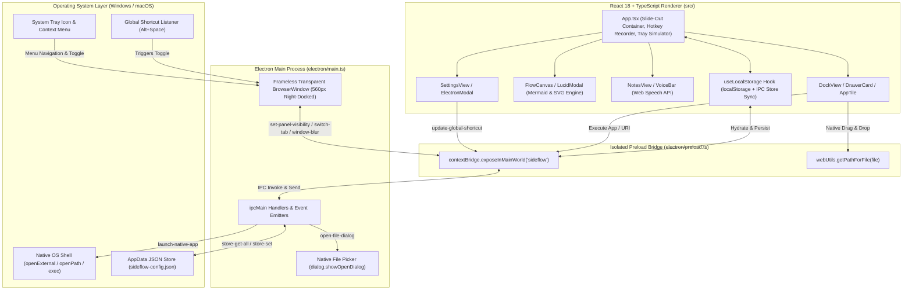

# SideFlow — Background Slide-Out Desktop Utility Panel

**SideFlow** is a cross-platform, always-available desktop background utility built with **Electron**, **React 18**, **TypeScript**, **Tailwind CSS**, and **Lucide Icons**. Designed for developers, architects, and power users, SideFlow lives quietly in the OS system tray (`skipTaskbar: true`) and slides out smoothly from the right edge of the primary monitor via a configurable global keyboard shortcut (default: `Alt + Space`), system tray menu, or a subtle screen-edge peek handle.

It unifies three high-frequency daily workflows into a single zero-context-switching glassmorphic panel—and includes an interactive **Desktop Simulation Mode** when run in a standard web browser.

---

## Table of Contents

1. [Executive Summary & Core Workflows](#1-executive-summary--core-workflows)
   - [ObjectDock-Style Categorized App Drawers](#11-objectdock-style-categorized-app-drawers)
   - [On-The-Fly Flowchart Scratchpad with Lucidchart Mermaid Bridge](#12-on-the-fly-flowchart-scratchpad-with-lucidchart-mermaid-bridge)
   - [Voice-Dictated Multi-Note Scratchpad](#13-voice-dictated-multi-note-scratchpad)
   - [Configurable Global Hotkey Recorder & Window Management](#14-configurable-global-hotkey-recorder--window-management)
2. [Architecture & Tech Stack](#2-architecture--tech-stack)
3. [Project Directory Structure](#3-project-directory-structure)
4. [Getting Started](#4-getting-started)
   - [Prerequisites & Installation](#41-prerequisites--installation)
   - [Development Web Mode](#42-development-web-mode)
   - [Native Electron Tray Mode](#43-native-electron-tray-mode)
   - [Production Build & Packaging](#44-production-build--packaging)
   - [Running Automated Tests](#45-running-automated-tests)
5. [IPC Channels & Data Models Reference](#5-ipc-channels--data-models-reference)
   - [Electron IPC Channels](#51-electron-ipc-channels)
   - [Preload ContextBridge API (`window.sideflow`)](#52-preload-contextbridge-api-windowsideflow)
   - [Core TypeScript Data Models (`src/types/sideflow.ts`)](#53-core-typescript-data-models-srctypessideflowts)
   - [Workspace Persistence Keys](#54-workspace-persistence-keys)

---

## 1. Executive Summary & Core Workflows

### 1.1 ObjectDock-Style Categorized App Drawers
Organize and launch local executables, scripts, folders, web URLs, and custom application URI protocols from categorized, collapsible drawers:
- **ObjectDock Hover Physics:** App tiles animate with spring magnification on hover (`translateY(-6px) scale(1.12)` via `cubic-bezier(0.34, 1.56, 0.64, 1)`).
- **Categorized Drawer Management:** Create, double-click to rename, collapse/expand, filter via horizontal category pills, or delete drawers (e.g., *Development & Code*, *Diagramming & Creative*, *Communication & Media*).
- **Direct OS Drag-and-Drop:** Drag `.exe`, `.lnk`, `.app`, `.bat`, `.cmd`, `.sh`, `.ps1`, `.py`, media files, design assets, or URLs directly from Windows Explorer or macOS Finder onto any Drawer Card.
  - Drawers highlight with an indigo glow (`drawer-drop-active`) on `dragover`.
  - Native file paths are resolved via Electron's `webUtils.getPathForFile(file)` (with fallback support), and `inferAppMetaFromFilename()` automatically derives a clean display title, Lucide icon, and accent color based on file extension.
- **Native File Browser Dialog:** Each drawer header and the **Add / Edit App** modal include a **Browse** button wired to Electron's native `dialog.showOpenDialog` (`openFile`, `multiSelections`).
- **Instant Filter & Direct Launch:** Filter across all drawers in real time and press `Enter` in the search bar to immediately launch the top matching application or URL/URI command.
- **Hybrid Native Execution Engine:** Clicking any tile dispatches `launch-native-app` over IPC. Standard URLs and custom URI schemes (`vscode://`, `figma://`, `spotify://`, `slack://`, `ms-calculator://`) execute via `shell.openExternal()`, while local file paths execute via `shell.openPath()` with an automatic `child_process.exec` fallback.

### 1.2 On-The-Fly Flowchart Scratchpad with Lucidchart Mermaid Bridge
Rapidly sketch system architectures, decision trees, and API flows without leaving your active workspace:
- **Three Semantic Node Shapes:**
  - **Process (`process`):** Rounded rectangle in Sky Blue (`bg-sky-950/90`, `border-sky-400/70`)
  - **Decision (`decision`):** Dashed-border diamond/rounded-2xl card in Amber (`bg-amber-950/90`, `border-amber-400/80`)
  - **Terminal / Start-End (`start`):** Pill shape in Emerald (`bg-emerald-950/90`, `border-emerald-400/80`)
- **Interactive Drag & Inline Editing:** Freely drag nodes across the 20px dot-grid canvas with real-time edge recalculation. Double-click any node's label to rename it inline (`Enter` to commit, `Escape` to cancel).
- **Directed Cubic-Bezier Connectors:** Toggle **Connect** mode, click a source node, and click a target node to draw a smooth SVG cubic-bezier curve with an indigo arrowhead marker (`#arrowhead`). Click any connector path to remove it.
- **Bi-Directional Lucidchart Mermaid Bridge:**
  - Open **Lucidchart Sync** to auto-compile the canvas state into standard **Mermaid.js (`flowchart TD`)** syntax:
    - Process: `n1["Label"]`
    - Decision: `n2{"Label"}`
    - Terminal: `n3(["Label"])`
    - Directed Edges: `n1 --> n2` (or `n1 -->|Label| n2`)
  - Edit Mermaid code directly in the modal and click **Sync to Canvas** (`parseMermaidCode`) to reconstruct nodes and edges back on the visual canvas, **Copy Code** for one-step paste into Lucidchart (`Insert -> Mermaid`), or launch Lucidchart documents directly.
- **Standalone SVG Export:** Click **Download SVG** (`generateStandaloneSVG`) to export a self-contained, styled `.svg` file of the diagram.

### 1.3 Voice-Dictated Multi-Note Scratchpad
Capture meeting notes, sprint tasks, and voice memos with zero friction:
- **Multi-Note Pill Navigation:** Create, switch between, title, and delete multiple persistent notes.
- **Real-Time Web Speech API Dictation:**
  - Click the microphone button (with pulsing red recording ring `.recording-pulse`) to stream live speech-to-text into the active note using `SpeechRecognition` / `webkitSpeechRecognition` (`continuous: true`, `interimResults: true`).
  - Supports language selection (`en-US`, `en-GB`, `es-ES`, `fr-FR`, `de-DE`, `ja-JP`), live interim transcript preview, automatic restart on speech end while active, and a graceful simulated dictation fallback when running in restricted/sandboxed browser environments without microphone access.
- **Quick Note Utilities:** One-click **Insert Timestamp** (`[HH:MM AM/PM]`), one-click **Copy Note** to clipboard, and a live word/character counter with automatic local save indicator.

### 1.4 Configurable Global Hotkey Recorder & Window Management
Customize how SideFlow integrates with your desktop environment:
- **Interactive Keybinding Recorder:** In the **Settings** tab, click *"Click & Press New Shortcut Combo"* and press any modifier + key combination (e.g., `Alt + Space`, `Ctrl + Shift + Space`, `Alt + Q`). SideFlow updates the UI state and dynamically re-binds Electron's `globalShortcut.register()` via IPC, updating the System Tray tooltip and context menu label in real time.
- **Pin vs. Auto-Hide Mode:**
  - **Pinned:** Keeps the panel open alongside other desktop windows.
  - **Auto-Hide (Unpinned):** Automatically retracts the panel when the window loses focus (`window-blur` event in Electron or clicking the desktop background in Web Simulation mode).
- **Screen-Edge Peek Handle:** When retracted, an optional subtle handle remains docked on the right monitor edge (`#edge-peek-handle`) for instant mouse-click activation.
- **Workspace Backup & Reset:** Export all drawers, flowcharts, notes, and shortcut settings as a portable `sideflow-backup.json` file or restore factory defaults with one click.

---

## 2. Architecture & Tech Stack

SideFlow uses a strict process-isolated Electron architecture paired with a dual-mode React 18 frontend that runs seamlessly as both a native OS tray application and a standalone web application.



### Technology Stack Summary

| Layer | Technology | Purpose |
| :--- | :--- | :--- |
| **Desktop Shell** | **Electron 33** (`electron`, `electron-builder`) | Frameless transparent always-on-top window, System Tray, `globalShortcut`, native file & URI execution |
| **Frontend UI** | **React 18.3** + **TypeScript 5.7** | Component architecture, strongly typed state, custom hooks |
| **Build Tooling** | **Vite 6** + `concurrently` + `wait-on` | Instant HMR for web and synchronized Electron development |
| **Styling** | **Tailwind CSS 3.4** + Custom CSS3 Physics | Dark glassmorphism (`backdrop-blur-2xl`), cubic-bezier slide transitions, ObjectDock hover scaling |
| **Icons** | **Lucide React** (`lucide-react`) | Dynamic icon resolution (`DynamicIcon.tsx`) across drawers, tiles, and toolbars |
| **Persistence** | `localStorage` + Electron `userData` JSON Store | Instant synchronous state updates backed by `sideflow-config.json` in native mode |
| **Testing** | **Vitest 2** + **React Testing Library** + `jsdom` | Automated unit and component integration testing |

---

## 3. Project Directory Structure

```text
SideFlow/
├── electron/
│   ├── main.ts                         # Electron Main Process: BrowserWindow, Tray, globalShortcut, IPC, JSON store
│   ├── preload.ts                      # ContextBridge exposing safe window.sideflow API & webUtils.getPathForFile
│   └── icon.png                        # System tray & application icon asset
├── src/
│   ├── components/
│   │   ├── DockDrawers/
│   │   │   ├── AppTile.tsx             # ObjectDock-style magnified app tile with edit/remove actions
│   │   │   ├── DockView.tsx            # Search bar, category filter pills, drawer list, Add/Edit App & Drawer modals
│   │   │   └── DrawerCard.tsx          # Collapsible category drawer with native file/URL drag-and-drop zone
│   │   ├── Flowchart/
│   │   │   ├── FlowCanvas.tsx          # Interactive SVG bezier edge layer + draggable HTML nodes editor
│   │   │   └── LucidModal.tsx          # Bi-directional Mermaid.js generator/parser & Lucidchart launcher
│   │   ├── Notes/
│   │   │   ├── NotesView.tsx           # Multi-note tab bar, title/body editor, word/char counter
│   │   │   └── VoiceBar.tsx            # Web Speech API continuous dictation controller & timestamp/copy tools
│   │   ├── Settings/
│   │   │   └── SettingsView.tsx        # Global hotkey recorder, Pin/Auto-Hide, Edge Handle, JSON backup/reset
│   │   ├── DynamicIcon.tsx             # Maps icon identifier strings to Lucide React components
│   │   ├── ElectronModal.tsx           # Reference modal displaying native Electron wrapper setup & code
│   │   └── Header.tsx                  # Panel header with Pin/Auto-Hide badge, tab switcher, and collapse controls
│   ├── hooks/
│   │   └── useLocalStorage.ts          # Persistent state hook synced with localStorage and Electron userData store
│   ├── test/
│   │   └── setup.ts                    # Vitest + @testing-library/jest-dom test environment setup
│   ├── types/
│   │   └── sideflow.ts                 # Core TypeScript interfaces (AppDrawer, AppItem, FlowNode, NoteItem, etc.)
│   ├── utils/
│   │   ├── defaults.ts                 # Default drawers, starter flowchart, sample notes, and default shortcut
│   │   ├── fileMeta.ts                 # File path extraction, extension-based icon/color inference, app execution
│   │   └── mermaid.ts                  # Flowchart-to-Mermaid compiler, Mermaid-to-Flowchart parser, standalone SVG exporter
│   ├── App.tsx                         # Root slide-out container, global key listener, and Web Desktop Simulation view
│   ├── index.css                       # Tailwind directives, cubic-bezier transitions, ObjectDock hover & pulse animations
│   └── main.tsx                        # React 18 DOM entry point
├── index.html                          # HTML shell
├── package.json                        # Scripts, dependencies, and electron-builder packaging configuration
├── postcss.config.js                   # PostCSS configuration for Tailwind CSS
├── tailwind.config.js                  # Tailwind CSS theme and content scanning setup
├── tsconfig.json                       # TypeScript configuration for React renderer
├── tsconfig.electron.json              # TypeScript configuration for compiling electron/ to dist-electron/
└── vite.config.ts                      # Vite bundler and Vitest configuration
```

---

## 4. Getting Started

### 4.1 Prerequisites & Installation

- **Node.js:** `v18.0.0` or higher (LTS recommended)
- **npm:** `v9.0.0` or higher
- **OS:** Windows 10/11 or macOS (for native Electron tray packaging)

Install project dependencies from the repository root:

```bash
npm install
```

### 4.2 Development Web Mode

Run SideFlow in a standard web browser with Vite's Hot Module Replacement (HMR). When opened outside Electron, SideFlow automatically enables **Desktop Simulation Mode**, providing an interactive desktop background, top helper banner, and simulated OS taskbar/system tray menu:

```bash
# Start Vite dev server at http://localhost:5173
npm run dev

# Preview the production web bundle locally
npm run preview
```

### 4.3 Native Electron Tray Mode

Launch SideFlow as a frameless, right-docked native desktop overlay with live HMR, OS-level `Alt + Space` shortcut registration, System Tray icon, and native `.exe` / `.app` / URI launching:

```bash
# Run Vite dev server + compile Electron TypeScript + launch Electron concurrently
npm run electron:dev

# Or build both renderer and Electron main process and start Electron in production mode
npm run electron:start
```

### 4.4 Production Build & Packaging

Compile TypeScript, bundle the React frontend into `dist/`, compile the Electron main and preload scripts into `dist-electron/`, and package native desktop binaries via `electron-builder`:

```bash
# Compile TypeScript and build web + Electron bundles (dist/ and dist-electron/)
npm run build

# Package an unpacked native application directory into release/
npm run electron:pack

# Build distributable installers (NSIS & Portable .exe on Windows, .dmg on macOS) into release/
npm run electron:dist
```

### 4.5 Running Automated Tests

SideFlow uses **Vitest** and **React Testing Library** (`jsdom`) for automated verification:

```bash
# Execute the test suite once in CI/headless mode
npm test

# Run Vitest in interactive watch mode during development
npm run test:watch
```

---

## 5. IPC Channels & Data Models Reference

### 5.1 Electron IPC Channels

Implemented in [`electron/main.ts`](file:///g:/SideFlow/electron/main.ts) and bridged in [`electron/preload.ts`](file:///g:/SideFlow/electron/preload.ts):

| IPC Channel | Direction | Transport | Payload | Behavior |
| :--- | :--- | :--- | :--- | :--- |
| `launch-native-app` | Renderer $\rightarrow$ Main | `invoke` / `send` | `command: string` | Launches `http(s)://` URLs and custom URI schemes (`vscode://`, `spotify://`, etc.) via `shell.openExternal(command)`. Launches local file paths, scripts, and executables via `shell.openPath(command)` with a `child_process.exec` fallback. Returns `{ success: boolean; error?: string }`. |
| `update-global-shortcut` | Renderer $\rightarrow$ Main | `invoke` / `send` | `accelerator: string` | Calls `globalShortcut.unregisterAll()`, normalizes and registers the new Electron accelerator (e.g., `Alt+Space`), and refreshes the System Tray menu and tooltip. Returns `boolean`. |
| `set-panel-visibility` | Bidirectional | `send` | `visible: boolean` | **Renderer $\rightarrow$ Main:** Updates `isPanelVisible` state in main process and calls `mainWindow.show()` / `mainWindow.focus()` when opening.<br>**Main $\rightarrow$ Renderer:** Triggered by the global hotkey or System Tray toggle to animate the slide-out panel open or closed. |
| `open-file-dialog` | Renderer $\rightarrow$ Main | `invoke` | `void` | Opens the native OS file chooser (`dialog.showOpenDialog` with `['openFile', 'multiSelections']`) and returns `Promise<string[]>` of selected file paths. |
| `store-get-all` | Renderer $\rightarrow$ Main | `invoke` | `void` | Reads and parses `sideflow-config.json` from `app.getPath('userData')`, returning `Promise<Record<string, unknown>>`. |
| `store-set` | Renderer $\rightarrow$ Main | `send` | `{ key: string; value: unknown }` | Persists a key-value pair to `sideflow-config.json` in `app.getPath('userData')`. |
| `switch-tab` | Main $\rightarrow$ Renderer | `webContents.send` | `tab: TabId` | Dispatched when the user selects *Open App Drawers*, *Quick Flowchart*, *Voice Dictation Notes*, or *Configure Hotkey & Settings* from the native System Tray menu. |
| `window-blur` | Main $\rightarrow$ Renderer | `webContents.send` | `void` | Emitted when `mainWindow` loses OS focus (`blur` event), allowing the renderer to auto-retract the panel when in **Auto-Hide** (unpinned) mode. |

---

### 5.2 Preload ContextBridge API (`window.sideflow`)

[`electron/preload.ts`](file:///g:/SideFlow/electron/preload.ts) exposes a strongly typed `window.sideflow` object via `contextBridge.exposeInMainWorld('sideflow', sideflowAPI)` with `contextIsolation: true` and `nodeIntegration: false`:

```typescript
export interface SideFlowElectronBridge {
  isElectron: boolean;
  launchNativeApp: (command: string) => Promise<{ success: boolean; error?: string }>;
  updateGlobalShortcut: (accelerator: string) => Promise<boolean>;
  setPanelVisibility: (visible: boolean) => void;
  openFileDialog: () => Promise<string[]>;
  getPathForFile: (file: File) => string;
  onSetPanelVisibility: (callback: (visible: boolean) => void) => () => void;
  onSwitchTab: (callback: (tab: TabId) => void) => () => void;
  onWindowBlur: (callback: () => void) => () => void;
  storeGetAll: () => Promise<Record<string, unknown>>;
  storeSet: (key: string, value: unknown) => void;
}
```

---

### 5.3 Core TypeScript Data Models (`src/types/sideflow.ts`)

Defined in [`src/types/sideflow.ts`](file:///g:/SideFlow/src/types/sideflow.ts):

```typescript
export type AccentColor = 'indigo' | 'cyan' | 'emerald' | 'amber' | 'rose' | 'purple';

export type TabId = 'drawers' | 'flowchart' | 'notes' | 'settings';

export interface AppItem {
  id: string;
  name: string;
  cmd: string;       // Full OS file path (C:\...\app.exe) or URI (vscode://)
  icon: string;      // Lucide icon identifier
  color: AccentColor;
}

export interface AppDrawer {
  id: string;
  title: string;
  collapsed: boolean;
  apps: AppItem[];
}

export type FlowNodeType = 'process' | 'decision' | 'start';

export interface FlowNode {
  id: string;
  type: FlowNodeType;
  text: string;
  x: number;
  y: number;
}

export interface FlowEdge {
  from: string;
  to: string;
  label?: string;
}

export interface FlowchartState {
  nodes: FlowNode[];
  edges: FlowEdge[];
}

export interface NoteItem {
  id: string;
  title: string;
  body: string;
  updatedAt?: number;
}

export interface ShortcutConfig {
  alt: boolean;
  ctrl: boolean;
  shift: boolean;
  code?: string;
  key: string;
  label: string;     // e.g., "Alt + Space"
}

export interface ToastMessage {
  id: string;
  title: string;
  subtitle: string;
  icon: string;
}
```

---

### 5.4 Workspace Persistence Keys

Managed via [`useLocalStorage`](file:///g:/SideFlow/src/hooks/useLocalStorage.ts) in `localStorage` and mirrored to `sideflow-config.json` in Electron's `userData` directory:

| Key | Type | Default | Description |
| :--- | :--- | :--- | :--- |
| `sideflow_drawers` | `AppDrawer[]` | `defaultDrawers` (3 categories, 10 apps) | Categorized ObjectDock drawers and application tiles |
| `sideflow_flow` | `FlowchartState` | `defaultFlowData` (4 nodes, 3 edges) | Flowchart canvas nodes, coordinates, and directed edges |
| `sideflow_notes` | `NoteItem[]` | `defaultNotes` (2 starter notes) | Multi-note scratchpad titles, bodies, and timestamps |
| `sideflow_shortcut` | `ShortcutConfig` | `Alt + Space` | Active global keyboard shortcut configuration |
| `sideflow_pinned` | `boolean` | `true` | Whether the panel stays pinned (`true`) or auto-hides on outside click/blur (`false`) |
| `sideflow_edge_handle` | `boolean` | `true` | Whether the right-edge peek handle is visible when the panel is retracted |
